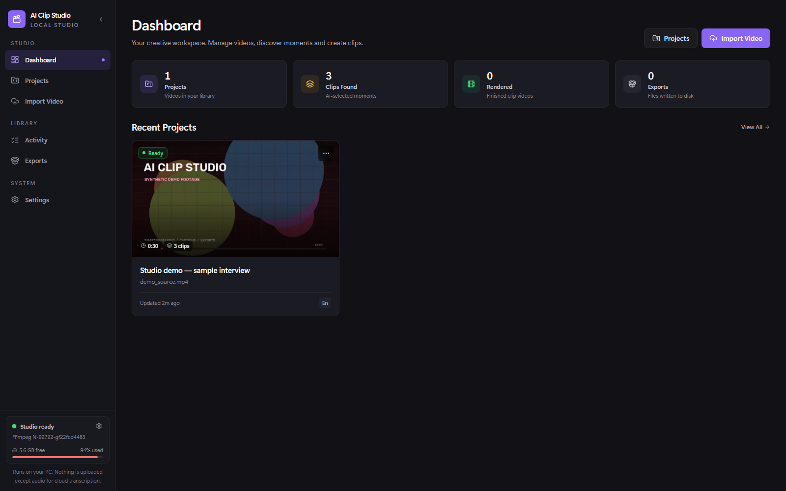
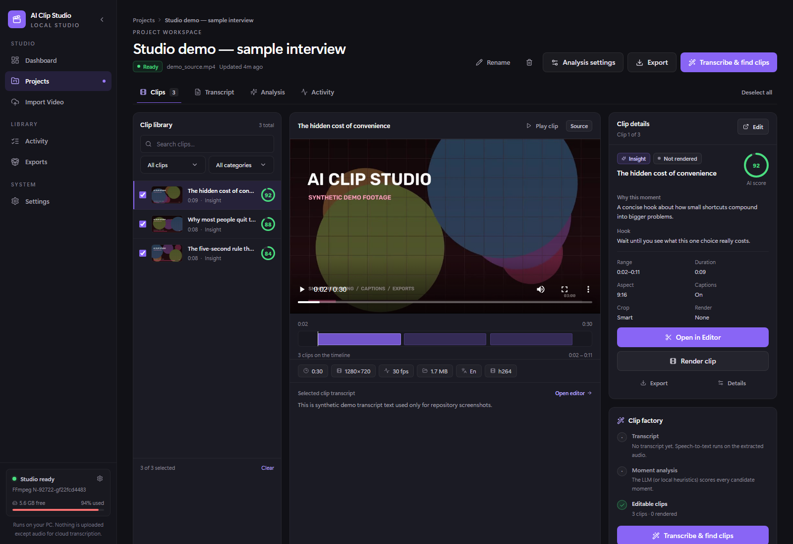
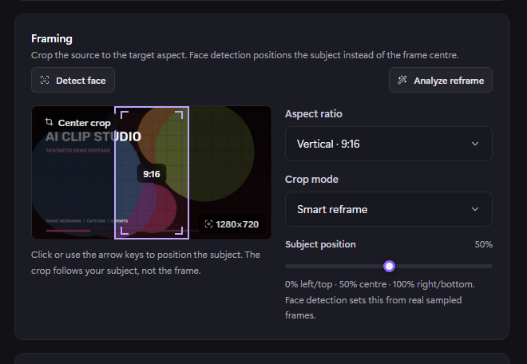

# AI Clip Studio

A local-first AI video clipping studio for Windows. Import a video, find the strongest moments, reframe them for vertical or square formats, caption them, render, and export — all from a local web UI.

The full source video stays on your machine. When you choose a cloud speech or LLM provider, only the extracted audio or transcript text is sent. Local Whisper, Ollama, and the built-in transcript heuristics can run the whole pipeline offline.

<p align="center">
  
</p>

<p align="center">
  
</p>

<p align="center"><em>Screenshots use synthetic demo footage.</em></p>

## What it does

- Imports MP4, MOV, MKV, WebM, AVI, M4V, MPEG, TS, MTS, M2TS, WMV, and FLV files, or direct HTTP(S) video URLs.
- Probes media, generates thumbnails, extracts mono 16 kHz audio, and stores metadata in SQLite.
- Transcribes with Google Gemini, Groq Whisper, local faster-whisper, or any OpenAI-compatible speech server.
- Imports existing SRT, VTT, or JSON transcripts.
- Finds clip candidates with Gemini, Groq, Ollama, an OpenAI-compatible LLM, or fully local transcript heuristics.
- Scores moments on hook, value, emotion, payoff, clarity, and more.
- Edits clip title, description, category, status, and start/end time.
- Reframes clips for 9:16, 16:9, 1:1, 4:5, or the original aspect ratio.
- Burns in word-level ASS captions with multiple caption presets.
- Renders individual clips with FFmpeg and real background-job progress.
- Exports individual clips or a ZIP archive.
- Uses NVIDIA NVENC when available, with automatic libx264 fallback.

## Intelligent reframing

The reframing engine is local and deterministic. It does not call a cloud vision API unless you explicitly use a vision provider for clip analysis.

- Samples the source clip locally with OpenCV.
- Detects faces with Haar cascades.
- Tracks motion with frame differences.
- Estimates saliency and text-like regions as fallbacks.
- Classifies the content as talking, podcast, interview, vlog, gaming, screen, entertainment, or general.
- Builds a smoothed subject path with velocity clamping and dead zones.
- Produces a time-aware FFmpeg crop expression instead of a single static crop.
- Falls back to center crop or a fitted/blurred-background layout when a crop would destroy important information.
- Produces a quality report with subject visibility, face visibility, stability, caption-overlap risk, and a recommendation.

Available crop modes: **Smart Reframe**, **Motion Track**, **Active Speaker**, **Gameplay Focus**, **Screen Focus**, **Fit Original**, **Face Aware**, **Center**, **Manual**, and **Blurred Pad**.

<p align="center">
  
</p>

## Requirements

- Windows 10 or 11
- Python 3.11+
- Node.js 20.19+ or 22.12+ (needed to build the frontend)
- FFmpeg and FFprobe
- Optional: an NVIDIA GPU for NVENC encoding
- Optional: API keys for Gemini or Groq, or a local Ollama/OpenAI-compatible server

## Quick start

```bat
git clone https://github.com/YOUR_USERNAME/ai-clip-studio.git
cd ai-clip-studio
setup.bat
start.bat
```

Replace `YOUR_USERNAME` with your GitHub username.

`setup.bat` handles the project dependencies:

| Installed by `setup.bat` | Installed by you |
| --- | --- |
| Python packages from `requirements.txt` | Python 3.11+ |
| Frontend packages from `package.json` | Node.js 20+ |
| Production frontend build | FFmpeg and FFprobe |

FFmpeg is a separate executable, not a Python or npm package, so it is not downloaded automatically. See the [FFmpeg section](#ffmpeg) below.

Then open:

```text
http://127.0.0.1:8765
```

Add provider keys in **Settings → AI Providers**. New installs keep media and the database in `storage/`; set `AICS_STORAGE_DIR` in `.env` if you want a different location.

For development, run the backend and Vite dev server separately:

```bat
.venv\Scripts\python.exe run.py
cd frontend
npm run dev
```

The Vite dev server proxies `/api` to `http://127.0.0.1:8765`.

## FFmpeg

FFmpeg is not committed to this repository. AI Clip Studio looks for it in this order:

1. `AICS_FFMPEG_PATH` / `AICS_FFPROBE_PATH`
2. `tools\ffmpeg\bin\ffmpeg.exe` and `tools\ffmpeg\bin\ffprobe.exe`
3. The system `PATH`

For a portable setup, download a Windows build and place the binaries here:

```text
tools/
  ffmpeg/
    bin/
      ffmpeg.exe
      ffprobe.exe
```

See [`tools/README.md`](tools/README.md) for links.

## Storage

New installs store media, thumbnails, renders, exports, logs, and the SQLite database inside the repository:

```text
storage/
  db/app.db
  uploads/
  audio/
  transcripts/
  thumbnails/
  clips/
  exports/
  config/secrets.dat
```

To keep an existing library, set `AICS_STORAGE_DIR` to its old location:

```text
AICS_STORAGE_DIR=D:\path\to\storage
```

The `storage/` directory and `.env` are ignored by Git.

## AI providers

| Job | Providers |
| --- | --- |
| Speech-to-text | Google Gemini, Groq Whisper, local faster-whisper, OpenAI-compatible |
| Clip analysis | Google Gemini, Groq, Ollama, OpenAI-compatible, local heuristics |
| Visual analysis | Local OpenCV, Google Gemini |

API keys can be entered in **Settings → AI Providers**. They are encrypted locally with Windows DPAPI and are never returned to the browser or written to logs.

You can also use environment-level keys for automated setups:

```text
AICS_GEMINI_API_KEY=
AICS_GROQ_API_KEY=
AICS_OPENAI_COMPATIBLE_API_KEY=
AICS_OPENAI_COMPATIBLE_BASE_URL=
```

Do not commit `.env` or real API keys.

## Privacy

- Full source videos never leave the machine.
- Only extracted audio or transcript text is sent to a cloud provider, and only when that provider is selected.
- API keys are encrypted with Windows DPAPI.
- Local Whisper, Ollama, and transcript heuristics can run fully offline.
- No analytics, telemetry, or external accounts are required.

## Tests

```bat
.venv\Scripts\python.exe -m pytest -q
```

The test suite covers the FastAPI health endpoint, core API contracts, and database initialization. Media-processing features require FFmpeg.

## Project structure

```text
backend/
  api/          FastAPI routes
  core/         configuration, secrets, logging
  database/     SQLAlchemy models and sessions
  providers/    speech and LLM integrations
  schemas/      Pydantic request/response models
  services/     imports, analysis, reframing, rendering, exports, jobs
frontend/
  src/          React + TypeScript UI
tests/          pytest smoke tests
branding/       app icon assets
tools/          optional bundled FFmpeg location
docs/           screenshots and documentation
```

## Configuration

Copy `.env.example` to `.env` and adjust the values you need. Common options:

| Variable | Default | Purpose |
| --- | --- | --- |
| `AICS_HOST` | `127.0.0.1` | Backend bind address |
| `AICS_PORT` | `8765` | Backend port |
| `AICS_STORAGE_DIR` | `.\storage` | Media, database, and secrets directory |
| `AICS_MAX_UPLOAD_MB` | `8192` | Maximum upload size |
| `AICS_MAX_CONCURRENT_JOBS` | `1` | Parallel background jobs |
| `AICS_PREFER_GPU_ENCODING` | `false` | Prefer NVENC when available |
| `AICS_LOG_LEVEL` | `INFO` | Log verbosity |

The backend deliberately binds to localhost only. It is not designed to be exposed to a network.

## Troubleshooting

**FFmpeg is not found.** Put `ffmpeg.exe` and `ffprobe.exe` in `tools\ffmpeg\bin`, add them to `PATH`, or set `AICS_FFMPEG_PATH` and `AICS_FFPROBE_PATH`.

**Port 8765 is already in use.** Stop the other AI Clip Studio instance, or start with `.venv\Scripts\python.exe run.py --port 8766`. The desktop shortcut expects port 8765.

**The frontend is blank or stale.** Rebuild it with `cd frontend && npm run build`, then restart the app.

**Rendering falls back to CPU.** NVENC requires a supported NVIDIA GPU and driver. Leave `AICS_PREFER_GPU_ENCODING=false` to always use libx264.

**A cloud provider fails.** Check the key, quota, and model name in the job log. Local transcript heuristics and Ollama work without a paid provider.

**I want a clean slate.** Stop the app, then remove the storage directory shown in the startup log (`storage\` for new installs). This deletes projects, clips, and encrypted keys.

## Desktop shortcut

For everyday use, run `create_desktop_shortcut.ps1` once. It creates a shortcut that:

- starts the backend hidden,
- opens the app in a standalone Chrome/Edge window,
- stops the backend when that window is closed.

`start.bat` remains available as the manual launcher.

## Known limitations

- Windows is the primary target because secret storage uses Windows DPAPI.
- Platform pages such as YouTube, TikTok, and Instagram cannot be downloaded. Only direct video URLs are supported.
- Cloud providers have real quotas and rate limits. Errors are shown in the job log instead of being hidden.
- The reframing engine uses local OpenCV heuristics. It is not a trained person/object detector, so unusual footage may need manual framing.
- AI thumbnail generation requires an image-generation provider, which is not included.
- The app is local-only and is not a hosted multi-user service.

## License

MIT. See [`LICENSE`](LICENSE).

FFmpeg is a separate project and is distributed under its own license. AI provider names and logos belong to their respective owners.
